# RoutePilot

**All-in-one pool service management software.** Route optimization, AI-assisted chemistry
tracking, automated billing, an offline field app for technicians, and a branded customer website
+ portal — for pool cleaning businesses that have outgrown spreadsheets and text threads.

[](https://github.com/rocketskatesninja/routepilot.pro/actions/workflows/tests.yml)
[](https://github.com/rocketskatesninja/routepilot.pro/actions/workflows/lint.yml)
[](LICENSE)

Built with **Laravel 12 · Inertia v2 · Vue 3 (TypeScript) · Tailwind**.

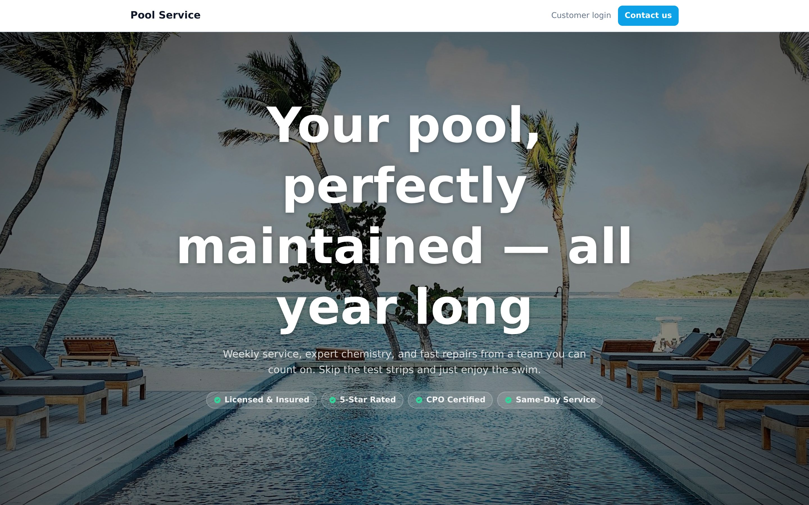

## What it does

- **A branded customer portal** — homeowners see when their tech is coming, how their water
  looked on the last visit (each reading checked against their pool's own targets), photos,
  their bill, and the services they get. They can add, pause, or stop a service themselves.
- **AI chemistry that thinks for your techs** — reads 12-visit trends and the 7-day forecast and
  tells the tech exactly what to add, on-device, even offline.
- **Smart routing + live operations** — pack more stops into fewer miles, then watch the day
  unfold live: pending, in-progress, and completed stops across every truck on one map.
- **A field app that works offline** — the water test is checked as it's typed, doses are worked
  out on the phone, and finished visits queue until there's signal again.
- **Emails customers want to open** — a visit report with the water-test bars and photos after
  every visit, reminders the day before, invoices and receipts, all in the company's colors.
  Customers choose which ones they get, and every optional email has a one-click unsubscribe.

## Screenshots

All from the seeded demo company ("Demo Company"), no real customer data. The full tour (every
back-office page in light + dark, the complete field-app flow in both themes, and every customer
portal page on a phone, the main ones on a desktop — 51 screens in all) lives in
[`public/assets/images/screenshots/tour/`](public/assets/images/screenshots/tour/), and
`npm run screenshots:tour` re-shoots it.

**Back office** (tenant admin)

| Dashboard | Route map |
|---|---|
| 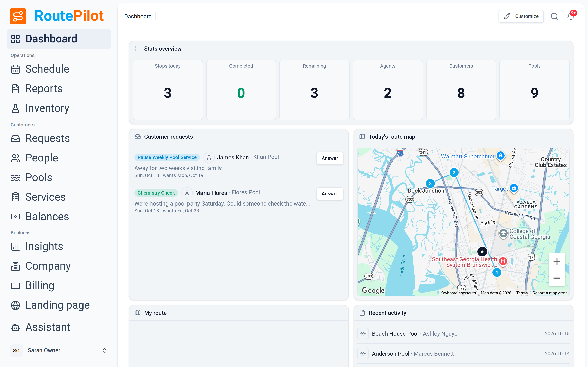 | 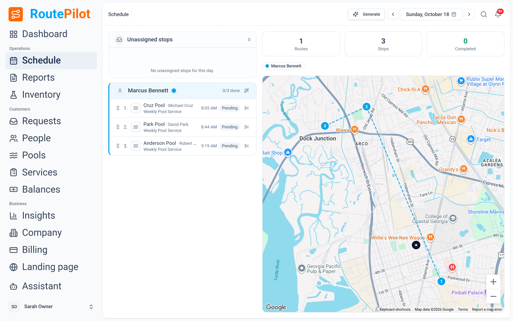 |

| Pools (master-detail) | Customer requests |
|---|---|
| 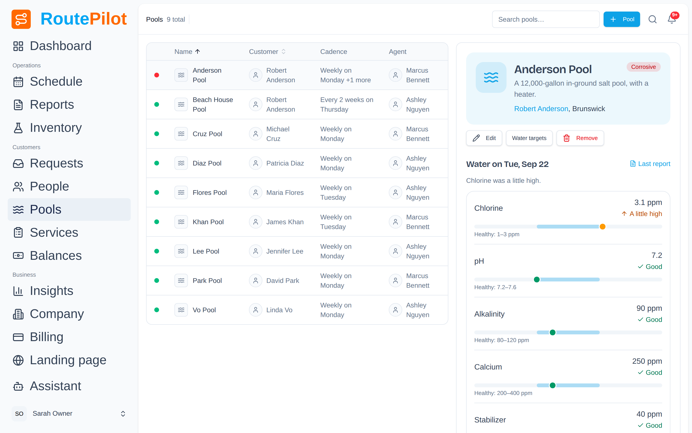 | 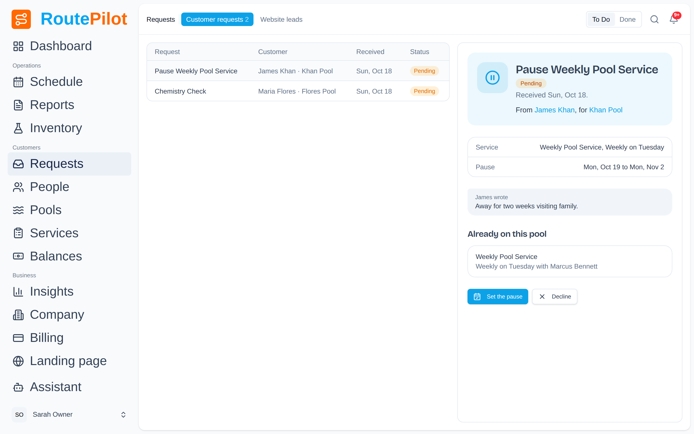 |

<sub>Dark theme: [dashboard](public/assets/images/screenshots/tour/tenant/dark/dashboard.png) ·
[schedule](public/assets/images/screenshots/tour/tenant/dark/schedule.png) ·
[pools](public/assets/images/screenshots/tour/tenant/dark/pools.png) ·
[insights](public/assets/images/screenshots/tour/tenant/dark/insights.png)</sub>

**Agent field app** (offline-resilient PWA)

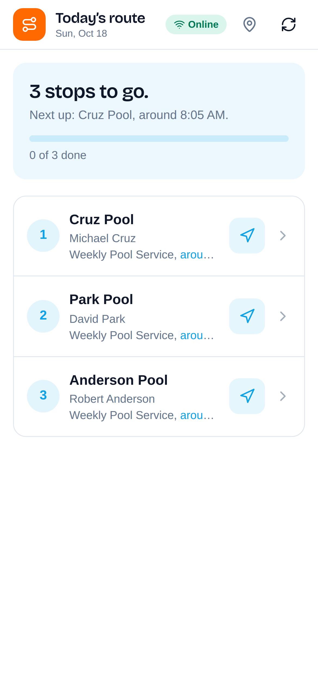 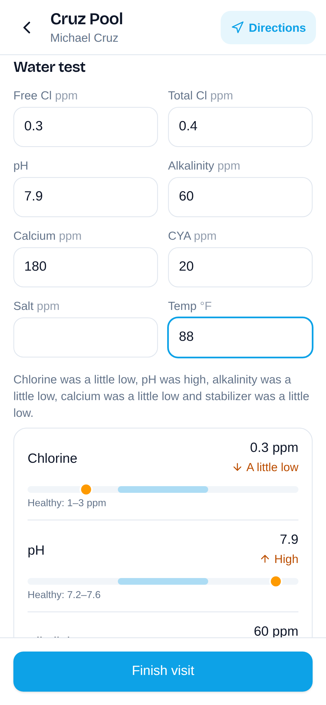 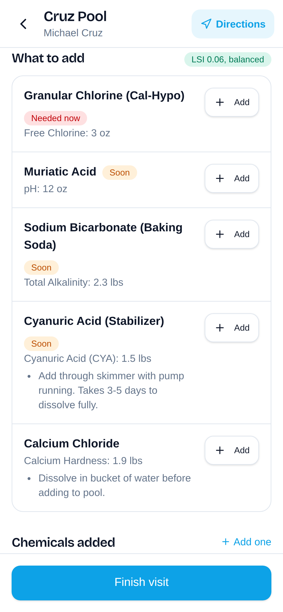

Today's route, the water test checked against the pool's targets as it's typed, and the on-device
chemistry engine's doses — worked out on the phone, no round trip to a server. Offline, the route
keeps working from the phone's copy and finished visits wait to sync
([offline](public/assets/images/screenshots/tour/agent/day-offline.png) ·
[queued](public/assets/images/screenshots/tour/agent/day-queued.png)).

**Customer portal**

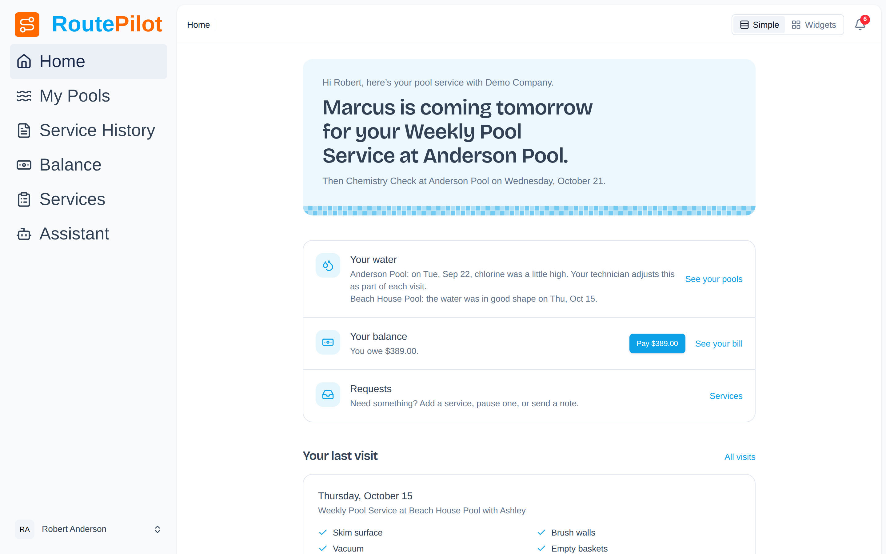

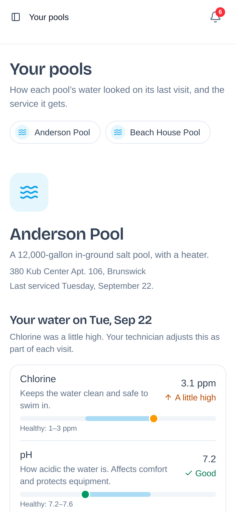 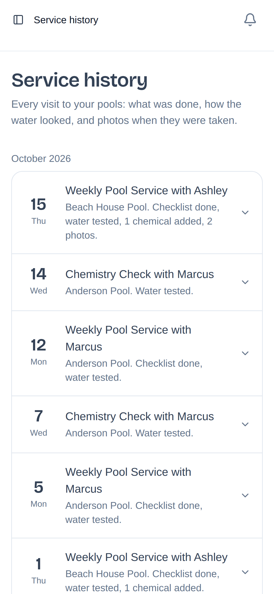 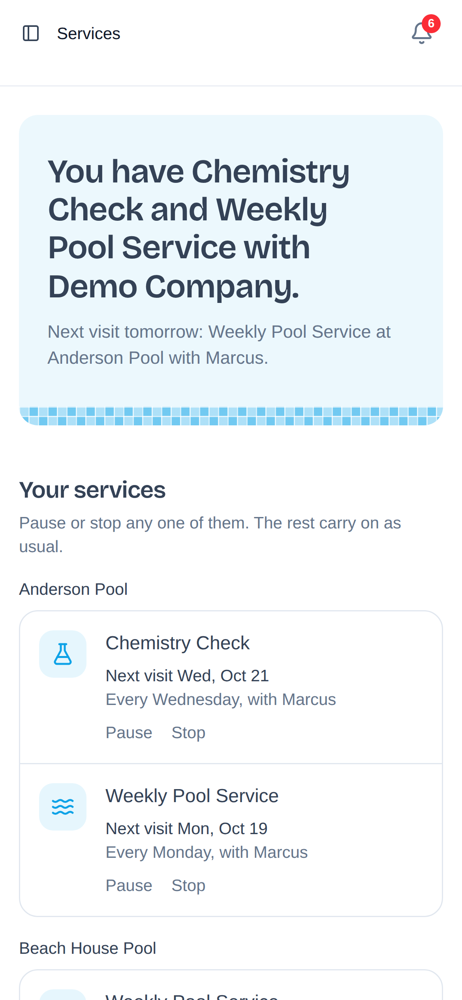

Home leads with the next visit, in plain words. My Pools shows each pool's last water test,
Service History every visit with its photos, and Services lets the homeowner add, pause, or stop
a service. Home can be this simple page or a drag-and-drop widget grid (the default), whichever
the customer prefers.

The public landing page (hero image above) is the fourth surface — same tenant, same data,
rendered SSR with per-tenant branding.

## Feature grid

| | | |
|---|---|---|
| **Live route status** — real-time per-stop badges and live map colors across every agent | **Automated billing & autopay** — invoices, receipts, and card-on-file autopay run themselves | **Inventory management** — chemical usage auto-deducts from every service visit |
| **Visit reports** — photos, checklist, and the water test emailed after every visit | **Build-your-own dashboard** — drag-to-reorder widgets for stops, map, weather, and billing | **AI assistant** — ask about a customer, a route, or pool chemistry in plain English |
| **Drag-to-reassign** — move a stop to another tech and every future visit follows | **Customer requests inbox** — add, pause, and stop requests from the portal, answered in one click | **Insights** — revenue, visits, receivables aging, and top techs at a glance |
| **⌘K search** — jump to any customer, pool, agent, or page | **Email preferences** — customers pick their emails; signed one-click unsubscribe (RFC 8058) | **Role-aware access** — techs see their own reports unless the office grants Agent+ |

## Architecture

Four surfaces, one codebase:

1. **Back-office** (tenant admin) — light + dark "ops" themes, customizable dashboards.
2. **Agent field PWA** — offline-resilient, installable, light + dark.
3. **Customer portal** — lightweight, online-only.
4. **Public landing** — SSR, section-based page builder, per-tenant branding.

- **Multi-tenant:** shared schema + `tenant_id` scoping (`BelongsToTenant` concern +
  `TenantScope`); tenant resolved from session (staff) or custom domain/subdomain (public).
- **Conventions:** thin controllers → Form Requests → single-purpose Action classes; Eloquent
  relationships and query scopes over raw SQL; `declare(strict_types=1)` everywhere.
- **Security:** privilege/identity fields (`role`, `tenant_id`, `is_active`) are never
  mass-assignable — set only via `forceFill()` at controlled call sites; route-model bindings
  resolve after the tenant is bound, so another company's ids simply 404; Google OAuth requires a
  verified email and a linked `google_id`, never an email-match login; optional TOTP two-factor
  with recovery codes; secrets are `encrypted` at rest; unsubscribe and payment links are signed;
  policies/gates on every sensitive action with audit logging on billing, permissions, deletes,
  and impersonation.
- **Theming:** CSS-variable design tokens (`resources/css/app.css`), daylight + dark "ops" themes,
  per-tenant brand color overlay at runtime.

See `CLAUDE.md` for the full engineering charter.

## Quality gates

```bash
./vendor/bin/pest                 # tests
./vendor/bin/pint --test          # PHP code style (PSR-12 via Pint)
./vendor/bin/phpstan analyse      # static analysis (Larastan, level 6)
npm run lint && npm run format:check
```

CI runs Pest tests, Larastan (PHPStan level 6) static analysis, Pint style checks,
ESLint/Prettier, and `composer audit` / `npm audit` security scans on every push and PR.

## Local setup

```bash
composer install
npm install
cp .env.example .env
php artisan key:generate
php artisan migrate
php artisan db:seed --class=DemoSeeder   # optional: seeds a demo tenant + sample data
npm run dev        # or: npm run build
php artisan serve
```

By default the app uses SQLite (`database/database.sqlite`); configure MySQL in `.env` for a
production-like setup.

The `DemoSeeder` creates a "Demo Company" tenant with one login per role, all password `password`:

| Role | Email |
|---|---|
| Super admin (platform) | `admin@routepilot.pro` |
| Tenant admin | `tenant@routepilot.pro` |
| Agent (field app) | `agent@routepilot.pro` |
| Customer (portal) | `customer@routepilot.pro` |

## License

Source-available for portfolio and review purposes — see [LICENSE](LICENSE). Not open source; no
reuse or redistribution rights are granted.
