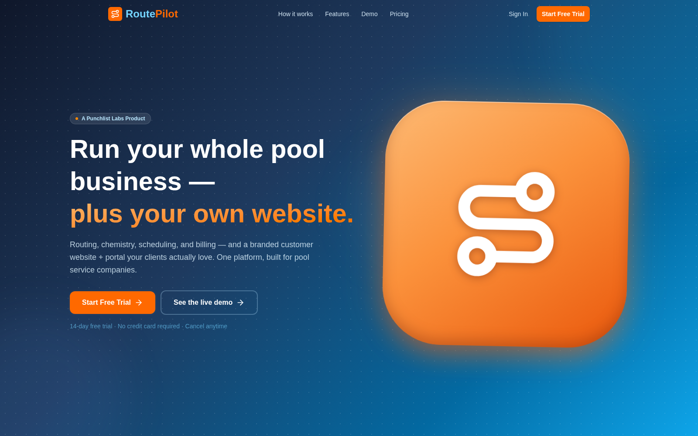
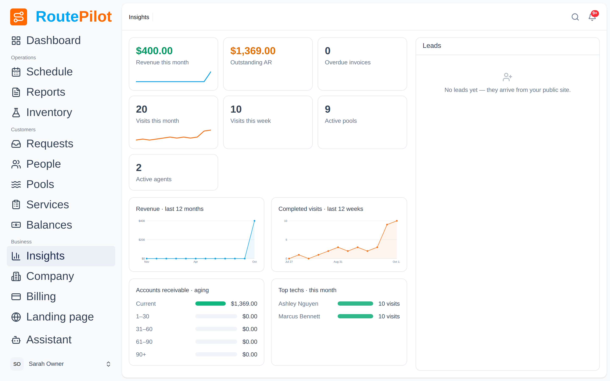

<h1 align="center">RoutePilot</h1>

<strong>Run your whole pool business — plus your own website.</strong>

All-in-one software for pool service companies: route optimization, AI-assisted chemistry,
automated billing, an offline field app for technicians, and a branded customer website and
portal — for businesses that have outgrown spreadsheets and text threads.

<a href="https://routepilot.pro/t/demo"><strong>View the live demo →</strong></a>

---

## What it is

RoutePilot is a Laravel app that runs a pool service company end to end. The office plans
routes, bills customers, and watches the day unfold from one back office; technicians work from
an installable field app that keeps going without signal; and every company gets its own
customer website and portal, in its own colors, live the day it signs up. Four surfaces, one
codebase, with each company's data kept strictly to itself.

## Features

- **A customer website and portal per company** — a branded public site built from a
  live-preview page builder, plus a portal where homeowners see when their tech is coming, how
  their water looked on the last visit, photos, their bill, and the services they get. They can
  add, pause, or stop a service themselves.
- **Smart routing and live operations** — pack more stops into fewer miles, then watch the day
  live: pending, in-progress, and completed stops across every truck on one map. Drag a stop to
  hand it to another tech.
- **AI chemistry** — reads 12-visit trends and the 7-day forecast and tells the tech exactly what
  to add, worked out on the phone, even offline.
- **An offline field app** — the water test is checked against the pool's own targets as it's
  typed, doses are worked out on the device, and finished visits queue until there's signal.
- **Billing that runs itself** — every visit charged at its plan's price, monthly invoices
  emailed with a pay-online link, card-on-file autopay with retries, partial payments, and a
  full payment history with Stripe references.
- **Emails customers want to open** — a visit report with the water test and photos after every
  visit, reminders the day before, invoices and receipts, all in the company's colors, with
  one-click unsubscribe on every optional email.
- **Inventory** — chemical usage deducts automatically from every service visit.
- **Build-your-own dashboard** — drag-to-arrange widgets for stops, the map, weather, and
  billing.
- **AI assistant** — ask about a customer, a route, or pool chemistry in plain English.
- **Insights** — revenue, visits, receivables aging, and top techs at a glance.
- **Security built in** — per-company data isolation, optional two-factor sign-in, signed
  payment and unsubscribe links, and an audit log of billing, permission, delete, and
  impersonation actions.

## The public site

Every company gets a customer-facing website out of the box.

A company's public site — built and branded from the back office, rendered server-side.

## The customer portal

Homeowners sign in to see their service, their water, and their bill.

<table>
<tr>
<td width="33%"> My Pools — each pool's last water test</td>
<td width="33%"> History — every visit, with photos</td>
<td width="33%"> Services — add, pause, or stop a service</td>
</tr>
</table>

## The back office

Plan, dispatch, and bill from one place.

<table>
<tr>
<td width="50%"> Schedule — every route on one live map</td>
<td width="50%"> Pools — the list, with each pool's latest water test</td>
</tr>
<tr>
<td width="50%"> Insights — revenue, visits, and receivables at a glance</td>
<td width="50%"> Requests — portal requests, answered in one click</td>
</tr>
</table>

## The field app

An installable app for technicians that keeps working without signal.

<table>
<tr>
<td width="33%"> Today — the route, stop by stop</td>
<td width="33%"> Water test — checked as it's typed</td>
<td width="33%"> Doses — worked out on the phone</td>
</tr>
</table>

Every screen, light and dark, is in <a href="public/assets/images/screenshots/tour/">the full tour</a> (51 screens).

## Pricing

| | RoutePilot |
|---|---|
| **Price** | $34.99/mo |
| Pools | 50 included, then $0.50/mo each |
| Technicians | 2 included, then $10/mo each |
| Back office, field app & customer portal | ✓ |
| Branded public website | ✓ |
| AI chemistry & assistant | ✓ |
| Online payments & autopay | ✓ |

14-day free trial, no credit card required.

## Built with

Laravel · Inertia · Vue 3 (TypeScript) · Tailwind CSS · MySQL/MariaDB · Laravel Cashier
(Stripe) · Laravel Reverb · Google Maps · Anthropic & OpenAI

## License

**All rights reserved.** This repository is public for demonstration and
reference purposes only — it is not open source. You may not copy, reuse,
redeploy, or redistribute this code, in whole or in part, without prior
written permission. See [LICENSE](LICENSE) for the full terms.

---

© 2026 Punchlist Labs. All rights reserved.

